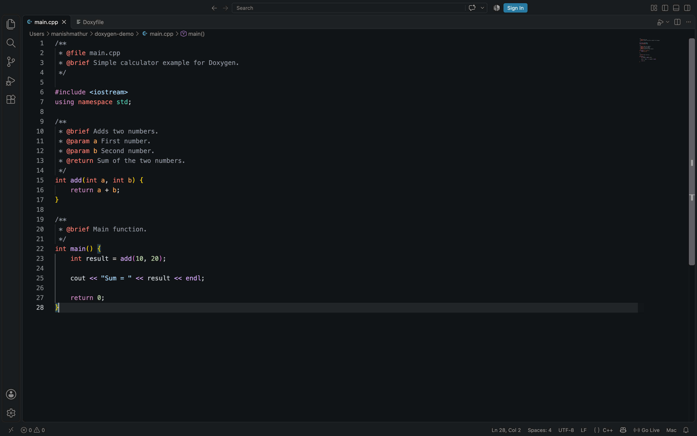
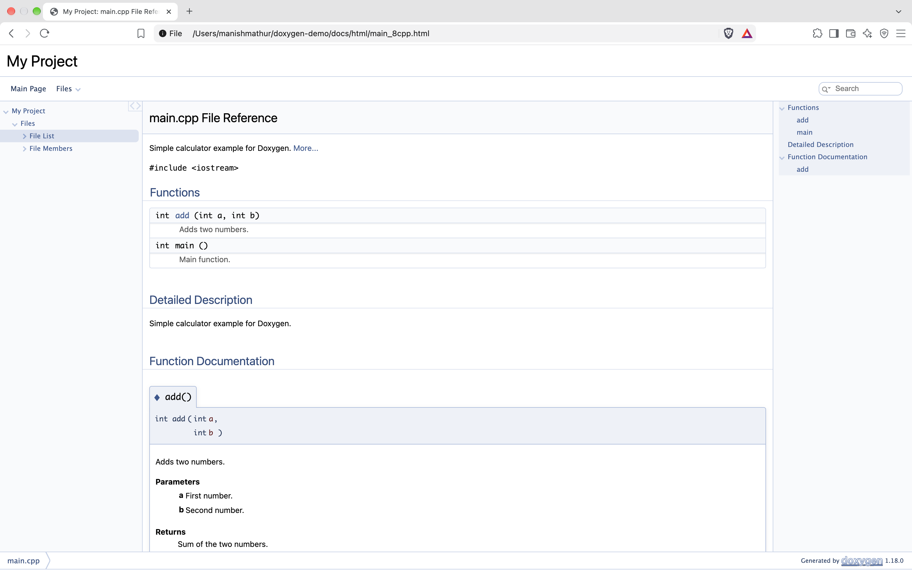
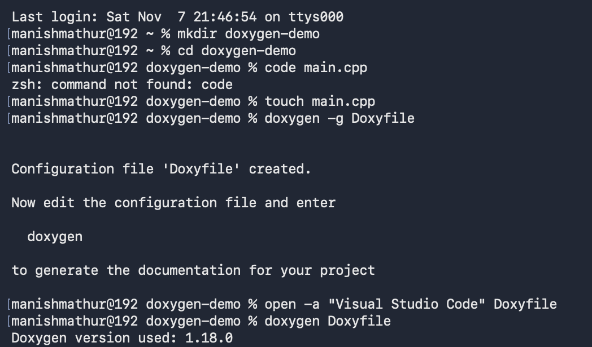

# Doxygen

## 1. Introduction
Open-source documentation generator used to create documentation directly from source code.
It supports languages such as C, C++, Java, and Python.
It helps developers understand, maintain, and document their projects.

## 2. Key Features
- **Automatic Documentation:** Generates documentation from source code.
- **Multiple Languages:** Supports C, C++, Java, Python, and more.
- **Code Linking:** Connects documentation with source code.
- **HTML and PDF:** Generates documentation in different formats.
- **Search:** Helps navigate large code documentation.

## 3. Documentation Comments
Doxygen uses special comments in source code to describe functions, classes, variables, and files.
Common comment styles:
- `/** ... */` – Block documentation comment.
- `///` – Single-line documentation comment.
These comments help Doxygen understand what needs to be documented.
### Source Code with Doxygen Comments

### Generated HTML Documentation

## 4. Common Doxygen Commands
Doxygen provides special commands to describe different parts of source code.
- `@brief` – Gives a short description.
- `@param` – Describes a function parameter.
- `@return` – Describes the returned value.
- `@author` – Specifies the author's name.
- `@file` – Describes a source file.
- `@see` – References related documentation.

## 5. Generating Documentation
Doxygen generates documentation by analysing source code and its documentation comments.
Basic steps:
1. Write documentation comments in the source code.
2. Generate a configuration file using `doxygen -g`.
3. Configure input files and output settings.
4. Run `doxygen Doxyfile`.
5. Open the generated HTML documentation in a browser.
### Terminal Commands

## 6. Output Formats
Doxygen can generate documentation in several formats:
- **HTML:** Documentation viewed in a web browser.
- **LaTeX:** Documentation that can be converted into PDF.
- **Man Pages:** Documentation for Unix-like systems.
- **XML:** Structured documentation data.
- **RTF:** Rich Text Format documents.

## 7. Advantages of Doxygen
- Reduces manual documentation work.
- Keeps documentation close to source code.
- Improves code readability and maintenance.
- Supports multiple programming languages.
- Makes large projects easier to understand.

## 8. Conclusion
Doxygen is a powerful documentation tool that simplifies the process of documenting source code. It improves code understanding, readability, and project maintenance.
