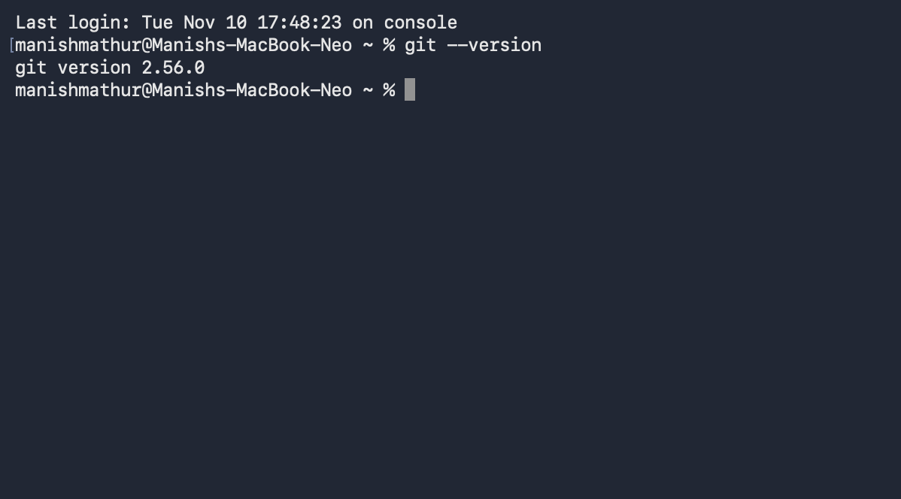
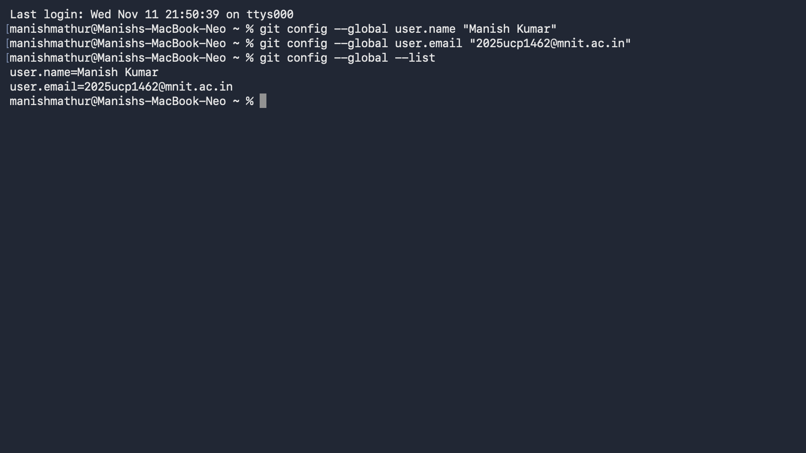
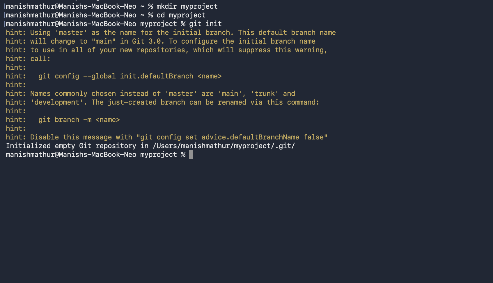

## 1. Introduction to Version Control
Version control is a system that records changes to files over time.

**Key Features:**
- Tracks modifications to files.
- Identifies who made changes and when.
- Restores previous versions when needed.
- Supports multiple contributors.

**Common Problems Without Version Control:**
- Files may get overwritten accidentally.
- Previous working versions may be lost.
- Finding the source of an error becomes difficult.
- Combining work from multiple contributors becomes complicated.
**Key Idea:** Version control keeps changes organized and makes project history easy to track.

## 2. Types of Version Control Systems
There are three main types of version control systems:
1. **Local Version Control:** Stores file versions on a local computer.
2. **Centralized Version Control:** Stores versions on a central server. Example: SVN.
3. **Distributed Version Control:** Every user has a complete copy of the repository. Example: Git.

## 3. Git: Introduction
Git is a distributed version control system used to track changes in files.
- Tracks changes in a project.
- Stores project history using commits.
- Supports branches for separate development.
- Allows offline work.
- Helps combine changes from different contributors.

## 4. How Git Works
Git works through three main steps:
1. **Working Directory:** Where files are created or modified.
2. **Staging Area:** Where changes are selected before committing.
3. **Repository:** Stores committed changes and project history.

## 5. Git Architecture
Git has three main components:
1. **Working Directory:** Contains project files.
2. **Local Repository:** Stores changes and commit history on the computer.
3. **Remote Repository:** Stores the project online and allows collaboration.

## 5. Installing and Verifying Git
Git can be installed on Windows, Linux and macOS.
**Verify Git Installation:**
Use the following command to check whether Git is installed:
```bash
git --version
```
**Git Version:**


## 6. Configuring Git
Before using Git, configure your username and email.
**Set Username, Email and verify configuration:**
```bash
git config --global user.name "Student Name"
git config --global user.email "student@example.com"
git config --global --list
```
**Name and Email:**


## 7. Creating a Git Repository
A Git repository stores project files and their version history.
**Steps to Create a Repository:**
```bash
mkdir my-project
cd my-project
git init
```


## 8. Basic Git Workflow
A basic Git workflow involves the following commands:
| Command | Purpose |
|---|---|
| `git status` | Checks the current repository status. |
| `git add .` | Stages all changes. |
| `git commit -m "message"` | Saves changes in the repository. |
| `git push` | Uploads commits to a remote repository. |

These commands help manage and track project changes.

## 9. Important Git Commands

| Command | Purpose |
|---|---|
| `git --version` | Checks the installed Git version. |
| `git config --global user.name "Name"` | Sets the Git username. |
| `git config --global user.email "email"` | Sets the Git email. |
| `git config --global --list` | Displays Git configuration. |
| `mkdir my-project` | Creates a new directory. |
| `cd my-project` | Changes the current directory. |
| `git init` | Initializes a new Git repository. |
| `git status` | Shows the current repository status. |
| `git add main.py` | Stages a specific file. |
| `git add .` | Stages all changes. |
| `git commit -m "message"` | Saves staged changes as a commit. |
| `git log` | Displays detailed commit history. |
| `git log --oneline` | Displays compact commit history. |
| `git diff` | Shows unstaged changes. |
| `git diff --staged` | Shows staged changes. |
| `git diff HEAD` | Shows all changes since the last commit. |
| `git ls-files` | Lists tracked files. |
| `git mv old.py new.py` | Renames or moves a tracked file. |
| `git rm old.py` | Removes a tracked file. |
| `git restore --staged main.py` | Removes a file from the staging area. |
| `git restore main.py` | Discards unstaged changes in a file. |
| `git revert COMMIT_ID` | Creates a new commit that reverses an earlier commit. |
| `git remote -v` | Displays configured remote repositories. |
| `git remote add origin URL` | Connects a remote repository. |
| `git branch` | Lists branches. |
| `git branch feature-login` | Creates a new branch. |
| `git switch feature-login` | Switches to another branch. |
| `git switch -c feature-login` | Creates and switches to a new branch. |
| `git merge feature-login` | Merges a branch into the current branch. |
| `git branch -M main` | Renames the current branch to main. |
| `git push -u origin main` | Pushes commits to the remote repository. |
| `git push` | Uploads local commits to the remote repository. |
| `git clone URL` | Copies a remote repository to the local computer. |
| `git fetch origin` | Downloads remote changes without merging them. |
| `git pull` | Downloads and integrates remote changes. |

## 10. Conclusion
Git is an important version control system that helps developers track changes and manage projects efficiently.
It provides features like commits, branches, merging and collaboration, making software development more organized and reliable.
