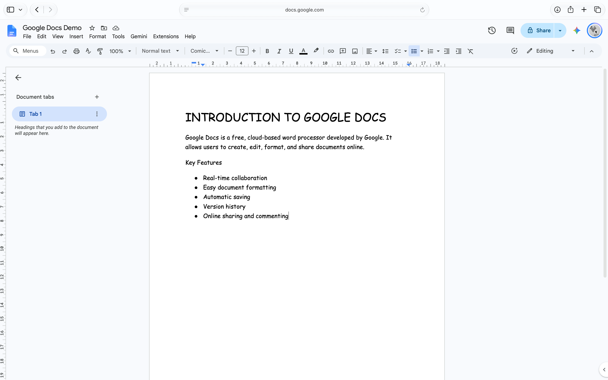

# Google Docs
### A Cloud-Based Document Creation and Collaboration Tool

## 1. Introduction
Google Docs is an online word-processing application developed by Google.
Unlike traditional offline word processors, Google Docs allows users to access their documents through the internet using different devices. Changes are automatically saved.
Real-time collaboration, which allows multiple users to work on the same document simultaneously.
Commonly used in academic, professional, and collaborative environments for preparing reports, assignments and technical documents.

## 2. Purpose of Google Doc
The primary purpose of Google Docs is to simplify document creation and make collaboration easier.
Its major purposes include:
- Creating and editing digital documents.
- Organizing information using headings, paragraphs, tables, and lists.
- Sharing documents with other users.
- Collecting feedback through comments and suggestions.
- Maintaining previous versions of documents.
- Accessing documents across different devices.

## 3. Important Characteristics
Google Docs has several characteristics that make it useful for document preparation:
1. **Cloud-Based Platform:** Documents are stored online and can be accessed from different devices.
2. **Automatic Saving:** Changes are saved automatically.
3. **Collaboration:** Multiple users can work on a document together.
4. **Document Formatting:** Provides tools for organizing and presenting information.
5. **Sharing and Permissions:** Allows users to control who can view, comment on, or edit a document.

## 4. Document Formatting
Google Docs provides formatting tools to make documents clear and organised.
- **Text formatting:** Change font, size, colour, and alignment.
- **Headings:** Use heading styles to organise content.
- **Lists:** Create bulleted and numbered lists.
- **Tables:** Arrange information in rows and columns.
- **Page layout:** Adjust margins, orientation, headers, and footers.

## 5. Collaboration and Sharing
Google Docs allows multiple users to work on the same document.
- **Viewer:** Can only view the document.
- **Commenter:** Can view and add comments.
- **Editor:** Can make changes to the document.
- **Suggesting Mode:** Suggests edits without directly changing the original text.
- **Comments:** Helps users discuss and review content.

## 6. Version History
Google Docs automatically saves changes and keeps previous versions of a document.
- Open **File → Version history → See version history**.
- View changes made over time.
- Restore an earlier version when needed.
- Rename versions to mark important milestones.

## 7. Inserting Elements
Google Docs supports different elements to improve document structure.
- **Images:** Insert images from a computer, Drive, or web.
- **Tables:** Organise information into rows and columns.
- **Drawings:** Create simple diagrams and illustrations.
- **Equations:** Insert mathematical expressions.
- **Lists:** Use bullets and numbering to organise points.

## 8. Citations and References
Google Docs provides a built-in citation tool for academic writing.
- Open **Tools → Citations**.
- Choose APA, MLA, or Chicago style.
- Add source details.
- Insert citations and generate a bibliography.

## 9. Exporting Documents
Google Docs allows documents to be downloaded in different formats.
- **PDF:** For sharing and printing.
- **DOCX:** For Microsoft Word.
- **ODT:** For OpenDocument editors.
- **HTML:** For web publishing.
- **TXT:** For plain text.

## 10. Best Practices
- Use headings to organise content.
- Maintain consistent fonts and formatting.
- Use comments for collaboration and feedback.
- Check spelling and grammar.
- Keep important versions backed up.

## 11. Conclusion
Google Docs is a useful tool for creating, formatting, and collaborating on documents.
Its cloud-based features make document management simple and efficient.
